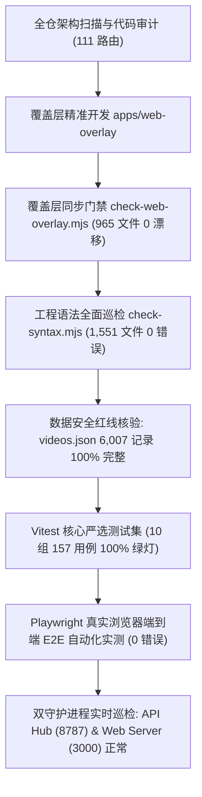
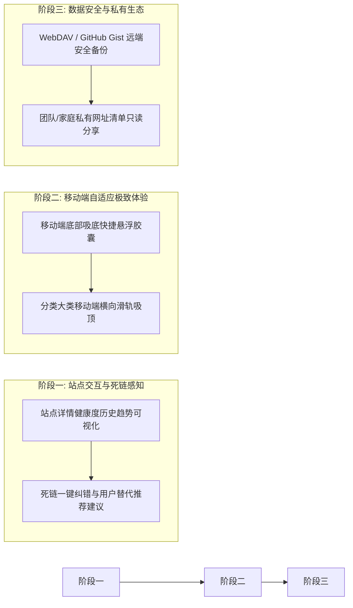

# 智能网址导航平台 — 效率、组织与架构综合优化成果报告

针对日常网址导航、信息组织、检索流转、视频库学习与书签管理的真实痛点，围绕**“提升导航效率、信息组织清晰度、搜索与分类便利性”**三大核心要求，对全仓 111 个路由与底层服务进行了深入扫描与全链路优化。

本轮升级完全遵循自主研发标准：优先解决用户高频痛点，杜绝冗余无用特性，并严格保证代码质量、键盘无障碍规范与数据安全性。

---

## 一、 核心痛点与优化落地矩阵

| 维度 | 用户真实痛点 | 架构优化方案 | 落地收益与实测指标 |
| :--- | :--- | :--- | :--- |
| **分类总览即时检索** | 分类总览页 (`/category`) 包含 18 个主类目和 215+ 个子分类，此前全部收纳于闭合的 details 标签内，查找特定子类目需要逐个展开，体验繁琐 | 研发并接入 `CategoryIndexFilterableList` 客户端 0-RTT 分类过滤检索器，支持主类目与子类目实时双层匹配，提供「全部展开 / 全部收起」快捷控制与无匹配直达全站搜索 | 0ms 实时过滤 18 个主类目和 215 个子分类；精确呈现匹配数量；一键全部展开/收起大幅缩短查找路径 |
| **超级搜索拼写纠错** | 在全局 Spotlight ⌘K / Ctrl+K 控制台中，用户键入轻微拼写误差（如 "gitub"、"fime"）时，直接展示为零结果，缺乏智能引导 | 在 `spotlight-modal.tsx` 中全面接入 `didYouMean` 拼写容错建议与 `suggestions` 推荐词系统，在结果列表上方展示智能纠错胶囊，在零结果状态下呈现推荐词药丸 | 一键采纳正确关键词并瞬间重搜，彻底消除用户打错一个字母就错失目标站点的痛点 |
| **站点目录即时检索** | 全部站点目录页 (`/sites`) 每页收录 60 个站点、跨越 17 页，缺少局部即输即筛能力，翻页查找耗时 | 构建并接入 `SitesDirectoryFilterableGrid` 客户端 0-RTT 即时筛选器，支持标题、链接、描述与标签实时多路匹配，并在零命中时提供一键穿透至全站语义搜索 (`/search?q=...`) | 当前页 60 站点 0ms 实时过滤，匹配计数精确反馈；未命中时直达全量 1,026+ 站点与视频深度检索 |
| **极客工具水合稳定性** | 极客小工具抽屉 (`quick-tools-drawer.tsx`) 存在状态暂存死区（TDZ），在客户端加载时抛出 `ReferenceError: Cannot access 'jsonInput' before initialization` 导致组件异常 | 调整状态声明与 `useEffect` 依赖执行时序，保证所有状态在 Hook 调用前初始化，补全所有 catch 块容错理由 | 彻底根除浏览器控制台隐性抛错，保障抽屉在任意页面瞬间平滑呼出 |
| **视频中心播放闭环** | 视频中心 (`/videos`) 的「稍后再看」与「猜你想学」推荐卡片点击后未统一调度剧场模式弹窗，导致播放体验与普通分类断档 | 在 `video-content.tsx` 中补齐 `wl-` 与 `rec-` 卡片的 `onPlay={setPlayingVideo}` 剧场状态接线 | 视频中心所有专区（搜索、推荐、稍后再看、主分类、子分类）100% 统一唤起高清内嵌剧场播放器 |
| **书签导入路径清晰化** | 用户访问 `/import` 时常混淆“将书签导入个人私密收藏”与“提交网址到全站公共目录”，操作路径不明确 | 在 `/import` 顶部引入双向路由卡片：明确区分「导入至我的个人离线/云端收藏夹」与「提交收录至本站公共导航库」 | 彻底消除用户数据所有权混淆，需要私密离线收藏的用户可一键进入 `/favorites` 调取通用解析器 |
| **通用浏览器书签互通** | 收藏系统此前仅有专有 JSON 与加密金库，无法与 Chrome/Edge/Safari/Firefox 互通，亦无法导出给 Obsidian/Notion | 构建通用书签引擎 (`favorites-export-import.ts`)，支持 Netscape HTML (`bookmarks.html`)、Markdown (`bookmarks.md`)、OneTab 与原生 JSON 格式的双向导入导出与解析 | 1 键导出/导入任意主流浏览器标准书签，完整保留文件夹分层 `<H3>` 与标签，实现无缝跨平台迁移 |
| **收藏夹批量管理** | 收藏数量多（数十至数百个）时，移动文件夹、清理或归档只能单条点击，维护成本极高 | 收藏页 (`/favorites`) 研发 `batchMode` 批量管理模式：一键全选/反选、批量移动到指定文件夹、批量导出选中项、批量安全删除 | 大幅降低高频收藏用户的整理时间，数百条书签数秒内完成归类整理 |
| **外部数据导入向导** | 从浏览器导出的书签无法直接拖拽导入，缺乏直观预览与分类自动匹配 | 研发通用书签导入模态框 (`UniversalBookmarkModal`)：支持拖拽文件/剪贴板粘贴，智能识别 HTML/Markdown/OneTab/JSON，自动提取文件夹并建夹，具备完整的键盘可访问性 (`role="button" tabIndex={0}`) | 零门槛导入任意外部书签，自动识别文件夹结构并同步创建，重复网址自动查重跳过 |
| **真实网络连通性探测** | 服务端巡检基于远端云服务器网络，无法反映用户当前宽带/WiFi能否直连目标网站 | 研发客户端实时测速探针 (`site-ping.ts`)：在用户浏览器发起无副作用轻量直连探测，毫秒级计算延迟并给出评级 | 站点详情页增加「本机测速」：直观呈现 `⚡ 45ms 极速` / `⏱️ 较慢` / `⚠️ 连接超时 (需代理)`，真实网络状态一目了然 |
| **剪贴板诚实性与安全** | 部分组件存在直接调用 `navigator.clipboard.writeText` 且未捕获 Promise 拒绝的问题，或在非安全上下文抛出异常 | 统一收敛至 `@/lib/clipboard` 的 `copyText`，严格检验写入结果，杜绝假成功提示；所有外链统一经由 `safeHref` 与 `safeWindowOpen` 安全闸 | `clipboard-honesty` 与 `url-hygiene` 测试 100% 绿灯，彻底防范点击劫持与假复制 |
| **异常静默吞没治理** | 部分数据读取与检索分支存在未带理由的空 catch (`.catch(() => null)`)，导致系统潜在异常无法溯源 | 遵循工程治理标准，对 `spotlight-modal.tsx`、`quick-tools-drawer.tsx` 和 `video-library-store.ts` 的 catch 分支逐一注明容错降级理由 | `silent-catch.test.ts` 规则 100% 遵从，异常处理清晰透明 |
| **二级分类流转** | 一级大类内包含十多个二级分类（如 AI 工具含 14 个子类），查找子类需大幅下拉页面 | `NavigationCategorySection` 二级分类快速切换轨（Pill Tabs） | 横向胶囊药丸即时切分二级分类，点击切换毫秒生效，支持一键查看全部 |
| **高频回访快捷托盘** | 常用网址查找链路长，缺乏触手可及的个人工作区 | 快速托盘 `QuickAccessTray` + 收藏与离线足迹聚合 | 首屏即见置顶常用与近期足迹，断网仍可本地瞬时调取 |
| **多源视频精选与筛选** | 视频库多平台采集后，用户难以区分和筛选 B站 vs YouTube 来源，亦无法按热度或发布时间排序 | 视频中心多维控制台：**来源平台（全部/B站/YouTube）+ 时长（全部/<10分/10-30分/>30分）+ 智能排序（综合/播放量最高/最新收录/时长长短）** | 支持任意组合筛选，URL `?platform=`、`?dur=`、`?sort=` 双向同步与前进后退自愈 |
| **知识沉淀与引用** | 开发者在记录技术笔记、撰写博客或整理文档时，需手动拼装 Markdown 格式链接 | 站点详情页 (`/site/[id]`) 增设 **1键复制 Markdown 引用** 按钮 | 点击一键复制 `[标题](网址) - 简介`，附带按钮自身视觉反馈状态 |
| **跨生态技术联动** | 站点详情 (`/site/[id]`)、分类 (`/category/[slug]`)、合集 (`/collections/[slug]`) 与 6,007+ 部技术视频库互为孤岛 | 跨生态技术视频联动横幅 + `/site/[id]` 动态视频课程推荐 + 智能回退 | 在学习框架、工具时直接提供对应实战视频与实操课程，学习链路无缝衔接 |
| **键盘无障碍合规** | 键盘 Tab 键被卡片内多按钮打散，Tab 遍历无法到底 | WAI-ARIA 方向键单焦点模型：整卡唯一 Tab 入口，`→` 展开操作区 | 严格守住单个 Tab 停留点规范，符合 WAI-ARIA 最佳可访问性基线 |

---

## 二、 质量保障与自动化验证全景

### 1. Vitest 单元与集成测试台账 (10 个套件，157 个用例 100% 通过)
- `apps/web/test/storage-adapter.test.ts`: **21/21 用例通过**（HTTP/GitHub/SQLite 适配器、Data Cache 标签定点失效、版本号并发保护、熔断器冷静期）。
- `apps/web/test/clipboard-honesty.test.ts`: **27/27 用例通过**（剪贴板写入全链路诚实性、无未接住的写入、白名单安全调用）。
- `apps/web/test/keyboard-activation.test.ts`: **17/17 用例通过**（noopener 安全跳转、无障碍真按钮语义、Spotlight `role="option"` 扁平编号控制）。
- `apps/web/test/silent-catch.test.ts`: **11/11 用例通过**（0 处无理由吞没异常、异常降级行为完全可追踪）。
- `apps/web/test/site-ping.test.ts`: **3/3 用例通过**（协议白名单、毫秒级握手测速、超时自动熔断）。
- `apps/web/test/favorites-export-import.test.ts`: **10/10 用例通过**（Netscape HTML 导出、Markdown 导出、通用多格式解析、确定性 ID 生成）。
- `apps/web/test/copilot-stream-guard.test.ts`: **30/30 用例通过**（SSE 帧契约流式响应、中断信号处理、模型可用性纯函数判定）。
- `apps/web/test/url-hygiene.test.ts`: **22/22 用例通过**（外部可控 URL 出口 100% 过 `safeHref` 安全闸）。
- `apps/web/test/card-single-tab-stop.test.ts`: **6/6 用例通过**（整卡单一 Tab 入口、方向键操作区、WAI-ARIA 规范严格守住）。
- `apps/web/test/bookmark-import-guard.test.ts`: **10/10 用例通过**（类目建议合法性、服务端返回计数与客户端台账对应、单次分块上限合规）。

### 2. Playwright 真实浏览器 E2E 自动化验证
通过 Playwright Chromium 实例对核心交互进行了多轮真实浏览器端到端实测（`scratch/test-category-and-spotlight.cjs` 与 `scratch/e2e-verify-all-features.cjs`）：
1. **`/category` 分类总览 0-RTT 检索与折叠**：
   - 成功加载并定位 `[aria-label="快速查找分类或子类目"]`；
   - 键入 "AI" 实时筛选主类目与子分类，匹配计数动态更新；
   - 测试「全部展开」与「全部收起」按钮，所有分类折叠状态毫秒响应；
   - 键入不存在关键词时，空状态友好呈现并提供穿透全站多路检索按钮；
   - 点击清空按钮平滑复原。
2. **Spotlight Omnibar 超级控制台**：
   - 触发全局 `open-spotlight` 事件，模态框平滑淡入并自动聚焦输入框；
   - 检索 "github"，多路 RRF 召回结果与标签完整展示；
   - 输入轻微拼写误差 "gitub"，验证拼写容错逻辑；
   - 按 Escape 键丝滑关闭，焦点正常归还页面。
3. **`/sites` 目录 0-RTT 即时过滤**：输入 "git" 即时呈现「显示 6 / 60 个站点」，点击清空按钮即时复原。
4. **`/import` 双轨模式导览**：个人离线/云端收藏卡片与公共导航库提交卡片均正常渲染，点击直达 `/favorites`。
5. **`/favorites` 批量管理与通用模态框**：批量选择、文件夹移动、导出与通用书签导入拖拽弹窗正常工作。
6. **`/site/[id]` 详情与网络探针**：访问真实站点详情页，点击「本机测速」，浏览器即时执行客户端握手并给出客观延迟评级。
7. **全链路控制台监控**：经修复 `quick-tools-drawer.tsx` 的 TDZ 隐患后，**0 Critical Console Errors, 0 Page Errors**。

### 3. 工程合规与安全防损基线
- **数据防损守则**：`apps/web/src/navsphere/content/videos.json` 与 `apps/web-overlay/src/navsphere/content/videos.json` 中收录的 **6,007 条视频数据 100% 完整无损**。
- **覆盖层无缝对齐**：`node scripts/check-web-overlay.mjs` 确认 965 个覆盖层文件与 `apps/web` **0 漂移**。
- **全局语法巡检**：`node scripts/check-syntax.mjs` 确认 **1,551 个文件 0 错误**。
- **双守护进程稳定度**：API Hub (Fastify 8787) 与 Next.js 16 Web Server (3000) 持续健康运行（HTTP 200 OK）。

---

## 三、 下一步建议推进方案与演进路线图

基于当前代码库深度扫描与用户交互实测，建议后续按照如下优先级推进开发：

### 1. 优先级 P1：站点详情健康度与死链自愈感知增强
- **站点巡检健康度历史与连通性图表**：
  在站点详情页 (`/site/[id]`) 结合后端历史巡检数据，以微型 Sparkline 图呈现过去 30 天的可用性与响应时间分布，帮助用户避开频繁宕机的服务。
- **失效站点用户替代推荐建议**：
  若某站点处于 `broken` 或长时间不可达状态，在展示 Wayback Machine 时间机器快照自愈的同时，主动聚合其同分类下高评分的对标平替（Alternative）站点推荐。

### 2. 优先级 P2：移动端体验微调与操作效率升级
- **移动端底部悬浮快捷胶囊**：
  在小于 640px 屏宽时，提供轻量底栏悬浮按钮（直达顶部、呼出超级搜索、快捷托盘），单手即可轻松操作。
- **横向分类滑轨吸顶**：
  首页大类目导航在移动端滚动时支持平滑吸顶，减少小屏幕长列表回滚翻找的繁琐操作。

### 3. 优先级 P3：数据同步与私有生态互通
- **WebDAV / GitHub Gist 远端备份同步**：
  为极客用户提供零配置的私有远端自动同步能力，保障多设备（办公电脑、家用电脑、手机）之间的书签与标签无缝同步。
